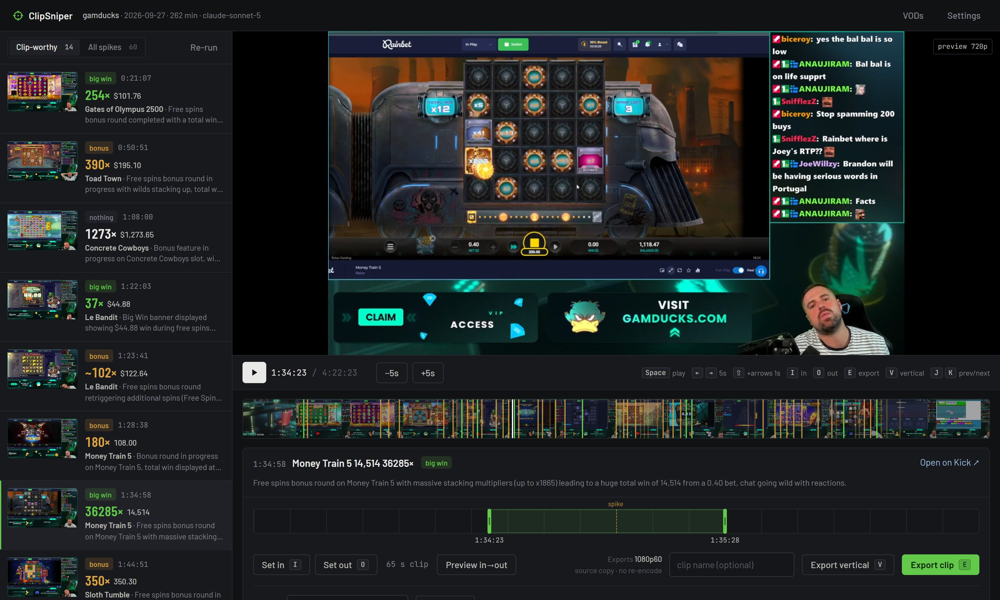

<h1 align="center">ClipSniper</h1>

<p align="center">
  <strong>Your VOD, sorted by what's worth clipping.</strong><br>
  Pick a Kick slot-stream VOD. ClipSniper finds the big wins and hype moments, lines them up next to a player with the stream itself, and cuts the clips you approve.<br>
  <a href="https://clipsniper.vercel.app">clipsniper.vercel.app</a>
</p>

<p align="center">
  
  
  
  
  
</p>

<p align="center"></p>

---

A four-hour slot stream has maybe five moments a viewer wants to see again. Finding them means scrubbing the VOD or trusting chat's memory. ClipSniper listens instead: it scans the VOD's audio for the spikes where a slot goes off and the streamer reacts, sends a few frames from each spike to Claude to read what happened, and gives you a review screen with every candidate ranked, the slot name, bet, win and multiplier filled in, and the VOD playing right there so you can scrub, set in and out points, and export.

Nothing is downloaded up front. The VOD stays on Kick and plays from Kick. Only the audio track, one small frame every 30 seconds, and the clips you export ever touch your disk.

## Contents

- [What it finds](#what-it-finds)
- [Quick start](#quick-start)
- [The app](#the-app)
- [How it works](#how-it-works)
- [Cost](#cost)
- [Command line](#command-line)
- [Configuration](#configuration)
- [ffmpeg](#ffmpeg)
- [Limitations](#limitations)
- [Privacy and legal](#privacy-and-legal)
- [Unsigned exe warning](#unsigned-exe-warning)
- [Roadmap](#roadmap)
- [License](#license)

## What it finds

Claude only reads the screen: slot, bet, win, banner, and whether a bonus is starting, running or ending. ClipSniper applies the rule itself, so the same frames always get the same verdict:

| kind | rule |
|---|---|
| **big win** | win ÷ bet of 100x or more, **or** a win of $1,000 or more, **or** a MEGA / EPIC / SENSATIONAL-tier banner when the numbers can't be read. A plain BIG WIN banner doesn't count, a number read off a lobby or paytable screen doesn't count, and a bought bonus only counts when it also paid 5× its price: a $500 super that returns $264 is a loss, whatever the base bet says. Both numbers are in Settings. |
| **funny** | a moment Claude rates 8/10 or funnier from the frames or the transcript, or a real scream (hype 9/10+) in the transcript. With a transcription key it hears what the streamer said, and the transcript adds moments the audio spikes missed. |
| **bonus** | a bonus round that never reached the big-win bar |
| nothing | normal spins, lobby browsing, ads, chat |

Big wins and funny moments are clip-worthy and shown first. One bonus is one entry: the three or four spikes a long bonus makes collapse into one, with the bonus's final total. The clip range stays tight around the loudest spike, the moment the hit landed, and takes in the summary screen only when it comes within a minute; a ten-minute bonus is not a clip. Everything else the audio flagged stays one tab away, so a miss is easy to recover.

On a 256-minute test VOD it checked 40 audio spikes and surfaced the stream's real wins (an 806x, a 601x, a 362x) at the top. The rest were bonus triggers, which sound just as loud but pay nothing yet, and the vision step sorted those out. On a second channel with a completely different overlay it read bets, wins and game names just as cleanly.

## Quick start

### Windows, no Python

1. Download `clipsniper.exe` from the [latest release](https://github.com/biceroy/clipsniper/releases/latest) and double-click it.
2. Your browser opens the app. Enter your Kick channel and an [Anthropic API key](https://console.anthropic.com/) in Settings. If ffmpeg isn't installed, ClipSniper fetches it on first use.
3. Click **Find moments** on a VOD. Extraction takes about 12 minutes for a 4-hour stream, then the vision step runs. The estimated cost is shown before anything is spent.
4. In the review screen, click a moment, scrub, set in and out, **Export**. Clips land in `out\<channel>-<date>\clips\`.

Keep the black console window open while you use the app; closing it stops ClipSniper.

### From source (Windows, macOS, Linux)

```bash
pipx install git+https://github.com/biceroy/clipsniper
clipsniper
```

or, without pipx:

```bash
git clone https://github.com/biceroy/clipsniper
cd clipsniper
pip install .
clipsniper
```

You need [ffmpeg](https://ffmpeg.org/) on your PATH (see [ffmpeg](#ffmpeg)) and Python 3.10 or newer.

## The app

ClipSniper runs a small local web app on `127.0.0.1` and opens it in your browser. Three screens:

**Pick a VOD.** The channel's last 30 streams as a grid, with duration and the date Kick will delete each one. Previous scans sit above, so a VOD you already processed opens instantly. You can also paste a `kick.com/…/videos/…` link.

**Scan.** A progress bar for extraction, then a live log as moments are classified, with the running API cost.

**Review.** Three parts on one screen:

- Left: the moment list. Clip-worthy first, each with a thumbnail, kind, time, slot, win and multiplier, and one line on what happens. A second tab shows every spike.
- Center: the VOD itself, playing straight from Kick at 720p. Under it, a filmstrip of the whole stream with a marker for every detected moment. Click anywhere to jump.
- Below: the trimmer. A 200-second window around the selected moment with draggable in and out handles, a preview button that plays exactly that range, an optional clip name, and **Export**. Clips are cut from the VOD's top rendition (1080p60 on Kick) with no re-encode, so video and audio are bit-exact copies of the source; the in point snaps to the keyframe just before your mark, so a clip may start a second early, never late. Exported clips appear in a tray at the bottom with a player and a download link.
- **Export vertical** re-encodes the range to 1080×1920 for TikTok, Shorts and Reels, in one of two layouts. *Blurred background* centres the 16:9 frame over a blurred copy of itself. *Cam on top, game below* stacks two crops: click **Edit layout**, then drag a box over the facecam and one over the game while a 9:16 preview beside the player shows the result. Each channel remembers its boxes. Tick **Burn in captions** and ClipSniper transcribes just that clip with word timings, then burns in three-word lines in bold caps. This needs the transcription key and costs under a cent a minute.

Keyboard: `Space` play/pause, `←`/`→` 5 s, `Shift` + arrows 1 s, `I` in, `O` out, `E` export, `V` export vertical, `J`/`K` previous/next moment.

**Re-run** in the review header re-classifies the cached spikes with another model. Extraction is skipped, and so is transcription once `transcript.json` exists, so only the vision step is paid again. Adding a transcription key after a scan makes the next Re-run transcribe.

## How it works

1. **Find the VOD.** Kick's public channel API lists the last 30 VODs with their HLS playlists. No login, no scraping.
2. **One ffmpeg pass.** Reads the 480p rendition, keyframes only, about 20x realtime. Out come a mono audio track and one JPEG every 30 seconds. Those JPEGs are also the filmstrip in the app.
3. **Audio spikes.** Loudness per second against a five-minute rolling median. The loudest moments, at least 75 seconds apart, become candidates.
4. **Vision.** Three frames around each spike (2 s before, 3 s after, 8 s after) go to Claude with a fixed prompt and a strict JSON schema. It reads the slot name, bet, win, banner and bonus stage off the game UI. The big-win rule above then decides the kind in code.
5. **Bonus totals.** Spikes from the same slot's bonus within 4 minutes merge into one entry. From the last one, Claude looks at the next 30-second frames already on disk (up to 9 minutes ahead) to find the summary screen and read the final total.
6. **Transcript (optional).** With a Groq or OpenAI key, the cached audio goes up in 10-minute chunks to Whisper. Claude reads the transcript in 15-minute windows for jokes, rants and reactions worth a clip, and each spike's classification gets what the streamer said around it.
7. **Review and cut.** The app plays Kick's own HLS stream in the browser (Kick's CDN allows it). Exports run `ffmpeg -c copy` on the highest-resolution, highest-frame-rate rendition in the master playlist (1080p60 on Kick) for the range you chose.

The code is one Python package with two files: `__init__.py` (pipeline, API, CLI) and `app.html` (the UI, plain HTML and JavaScript) plus a vendored copy of hls.js for playback. Two tests, no framework: `test_peaks.py` synthesizes audio with two known bursts and checks the detector finds exactly those; `test_judge.py` runs the big-win rule and the bonus merge against moments from a real scan.

## Cost

You pay Anthropic directly with your own key. Per VOD, with the default 60 spikes:

| model | approx. per 4-hour VOD | notes |
|---|---|---|
| `claude-haiku-4-5` | $0.30 | catches the wins, but misreads slot names and amounts |
| `claude-sonnet-5` (default) | $0.65 | reads the UI reliably |
| `claude-opus-5` | $1.60 | best descriptions; use it when the labels matter more than the price |

Transcription is optional and billed by the provider whose key you enter: about $0.17 per 4 hours on Groq (`whisper-large-v3-turbo`), $1.57 on OpenAI (`whisper-1`). Groq's free tier caps at 2 hours of audio per hour, so a long VOD waits partway through; use Groq's dev tier or OpenAI for long streams.

The app shows the estimate before you start a scan and the actual spend when it finishes.

## Command line

`clipsniper` alone opens the app. Everything else is for scripts:

| flag | what it does |
|---|---|
| `--channel SLUG` | Kick channel, the part after `kick.com/` |
| `--date 2026-09-20` | headless: scan this VOD (a date, a VOD id, a number from `--list`, or `latest`) and cut clips without the app |
| `--cut worthy` | headless clip policy: `none`, `worthy` (default) or `all` |
| `--top 60` | how many audio spikes to check |
| `--model claude-opus-5` | Claude model for the vision step |
| `--yes` | headless: don't ask before spending credits |
| `--list` | print the channel's recent VODs with their expiry dates and exit |
| `--port 8765` | port for the local app |
| `--no-browser` | start the app without opening a tab |
| `--out DIR` | output folder, default `./out` |
| `--limit-min 10` | only scan the first N minutes, for trying it out |
| `--setup` | enter channel and API key in the terminal instead of the app |

Example, fully headless:

```bash
clipsniper --channel gamducks --date latest --model claude-sonnet-5 --yes
```

## Configuration

Settings live in `%LOCALAPPDATA%\clipsniper\config.json` (Windows) or `~/.config/clipsniper/config.json` and are edited from the app's Settings panel:

```json
{
  "channel": "gamducks",
  "api_key": "sk-ant-...",
  "model": "claude-sonnet-5",
  "top": 60,
  "min_mult": 100,
  "min_win": 1000,
  "transcribe_key": "gsk_..."
}
```

`min_mult` and `min_win` set the big-win rule. `transcribe_key` is optional: a key starting `gsk_` uses Groq, anything else uses OpenAI. `ANTHROPIC_API_KEY` in the environment is used when the config has no Anthropic key.

Each scan writes to `out/<channel>-<date>/`: `moments.json` and `moments.md` (the results), `meta.json`, `frames/`, `clips/`, the cached `audio.pcm` so a re-run with another model skips extraction, and `transcript.json` when a transcription key is set.

## ffmpeg

ClipSniper does not ship ffmpeg. On Windows, if it isn't on your PATH, the first scan downloads the LGPL build from [BtbN's FFmpeg-Builds](https://github.com/BtbN/FFmpeg-Builds) into `%LOCALAPPDATA%\clipsniper\ffmpeg\`. If you'd rather install it yourself:

```bash
winget install ffmpeg
```

macOS: `brew install ffmpeg`. Linux: your package manager.

## Limitations

- **Loud is not the same as a win.** The audio pass finds loud moments; bonus triggers dominate the list and the vision step separates them. A quiet big win outside the top 60 spikes is missed. Raise the spike count in Settings if your streamer is calm.
- **Kick only, recent VODs only.** Kick lists the last 30 VODs and keeps each for about 30 days. The app shows the expiry date on every card.
- **No chat.** Kick's chat replay API returns a few seconds of messages per request, too slow for a whole VOD. Without a transcription key, "funny" is judged from frames alone.
- **8 kHz audio.** Whisper gets the same low-rate audio the spike detector uses. Speech comes through, but slot music can make it hallucinate lines like "thanks for watching".
- **Groq free tier.** It caps at 2 hours of audio per hour; ClipSniper waits out the limit, which slows long VODs.
- **Layout matters.** The slot UI has to be readable in a 480p frame. Tiny game windows or heavy overlays lower accuracy.
- **Playback needs the VOD to still be on Kick.** Once Kick deletes it, the review screen still shows the moments and thumbnails, but nothing can be played or exported.

## Privacy and legal

- ClipSniper reads **public** VODs through the same endpoints Kick's own site uses. It does not log in, does not touch private or subscriber-only content, and is not affiliated with Kick.
- What leaves your machine: frames around each moment (and the transcript text, if you set a transcription key) go to Anthropic's API under **your** key. With a transcription key, the VOD's audio goes to Groq or OpenAI under that key. Anthropic use is subject to [their terms](https://www.anthropic.com/legal/consumer-terms). The app itself binds to `127.0.0.1` only. No telemetry.
- Clipping someone else's stream is your responsibility. Use it on your own channel or with permission.
- MIT licensed. Do what you like; no warranty.

## Unsigned exe warning

The Windows build is produced by GitHub Actions from this repo with PyInstaller and is not code-signed. Windows SmartScreen and some antivirus products flag unsigned PyInstaller executables. If you'd rather not trust a binary, run from source; it's two files.

## Roadmap

- Twitch VODs and local files
- Chat as a second signal, once Kick offers a faster way to read a whole VOD's chat
- Time-per-slot and per-provider breakdown from the 30-second frames already on disk
- A sweep of all periodic frames for wins the audio missed

## License

[MIT](LICENSE)
